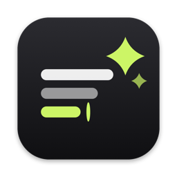
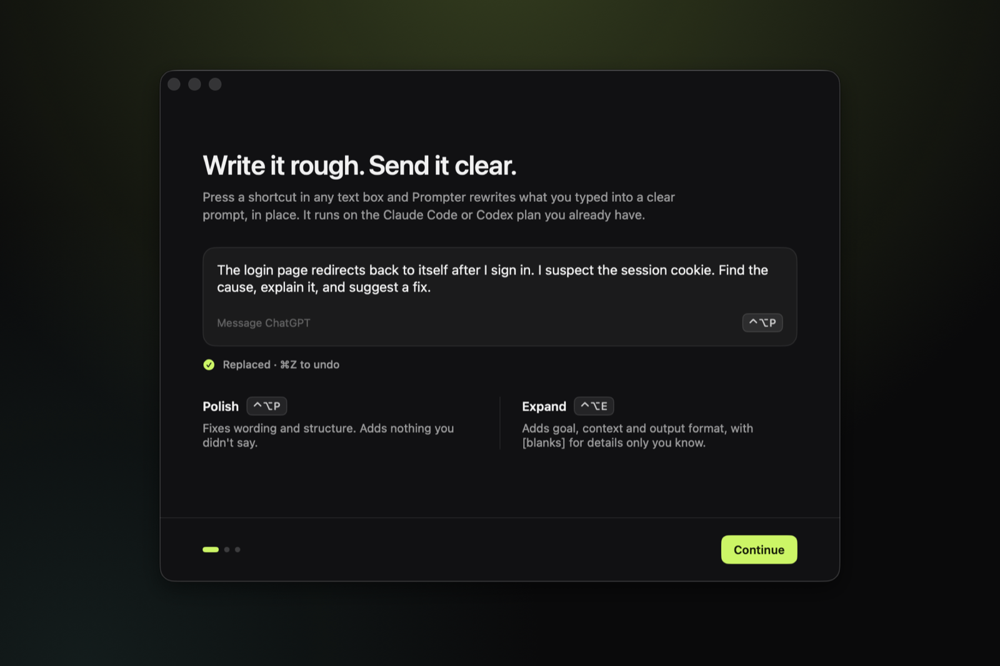
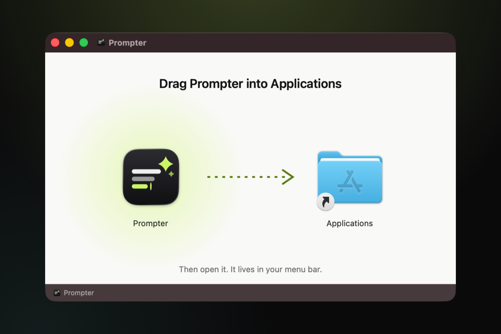
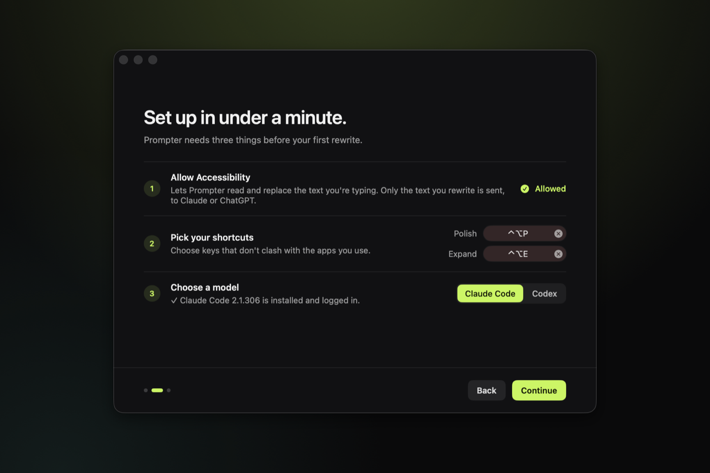
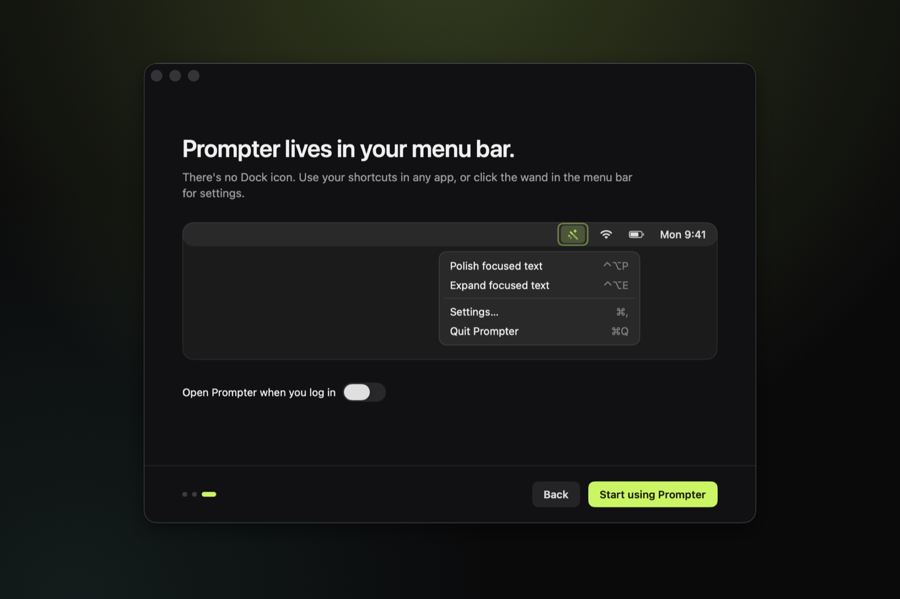

<p align="center">
  
</p>

<h1 align="center">Prompter</h1>

<p align="center">
  <b>Write it rough. Send it clear.</b><br>
  A macOS menu-bar app that turns whatever you're typing into a clear prompt, in place, with one shortcut.<br>
  It runs on the Claude Code or Codex subscription you already have. No API key and no extra bill.
</p>

<p align="center">
  <a href="https://github.com/Deveshb15/prompter/releases/latest"><b>Download for macOS</b></a>
  ·
  macOS 14 or later
  ·
  Signed and notarized
</p>

<p align="center">
  
</p>

## What it does

You type a rough draft into any text box: ChatGPT, Claude, Cursor, Slack, Notes, a browser. Press your shortcut. Prompter reads the text, rewrites it, and pastes the better prompt back in the same box. Press **⌘Z** to undo it.

| You typed | Prompter wrote |
| --- | --- |
| can u look at why the login page keeps looping back after i sign in, i think its the cookie thing | The login page redirects back to itself after I sign in. I suspect the session cookie. Find the cause, explain it, and suggest a fix. |

There are two modes, each with its own shortcut:

- **Polish** fixes wording and structure. It keeps your meaning, your code, links, file names, `@mentions` and `/commands` exactly as written, and adds nothing you didn't say.
- **Expand** turns a short ask into a complete prompt with a goal, context, scope and output format. Where it needs a detail only you know, it leaves a `[blank]` for you to fill in instead of guessing.

## Install

1. Download `Prompter.dmg` from the [latest release](https://github.com/Deveshb15/prompter/releases/latest).
2. Open it and drag Prompter into Applications.
3. Open Prompter. A short welcome guide walks you through setup.

<p align="center">
  
</p>

### Setup

Prompter needs three things, and the welcome guide covers each one:

1. **Accessibility permission.** This lets Prompter read and replace the text in the field you're typing in. Turn it on in System Settings → Privacy & Security → Accessibility.
2. **Two shortcuts.** One for Polish and one for Expand. Prompter ships with none set, so it never clashes with your apps.
3. **A model.** Install and log in to one of these:
   - [Claude Code](https://docs.claude.com/en/docs/claude-code) 2.1.293 or newer (`claude auth login`). Uses Haiku. About 3 seconds per rewrite.
   - [Codex CLI](https://github.com/openai/codex) (`codex login`). Uses GPT‑5.6 Luna. About 4–5 seconds per rewrite.

<p align="center">
  
</p>

Prompter lives in your menu bar and has no Dock icon. Click the wand for settings, or reopen the welcome guide from there.

<p align="center">
  
</p>

## How it works

- **Your subscription, your CLI.** Prompter runs your own logged-in `claude` or `codex` command. It never reads, copies or stores your login tokens. Each rewrite counts toward your plan's usage limits like any other request.
- **Fast on purpose.** It keeps one CLI process started and waiting, so a rewrite doesn't pay the startup cost. Each rewrite gets a fresh process, so nothing carries over between them.
- **Locked down.** The CLI runs with no tools, no MCP servers, no hooks, no project files and an empty working directory. It can only read your draft and write text back.
- **Safe replace.**
  - Prompter reads a selection or the whole text field. It never presses ⌘A blindly.
  - It checks that the text didn't change while the rewrite ran.
  - It restores your clipboard afterwards.
  - If the result looks off (a reply instead of a rewrite, a dropped link or code span, or far longer than your draft), it shows a preview and waits for you instead of replacing.
- **Terminals are special.** In Terminal, iTerm, Ghostty, Warp and similar apps, select the text first. The rewrite is copied to your clipboard instead of pasted, because a terminal can't replace text in place.

**Privacy:** the only text that leaves your Mac is the draft you choose to rewrite, plus the name of the app you're in. It goes to Anthropic or OpenAI through their own CLI. Prompter has no server, no analytics and no network code of its own.

## Build from source

You need Xcode 16+, [XcodeGen](https://github.com/yonaskolb/XcodeGen) and macOS 14+.

```sh
git clone https://github.com/Deveshb15/prompter.git
cd prompter
xcodegen generate
open Prompter.xcodeproj
```

`project.yml` signs Debug builds with the author's Apple Development certificate. This keeps macOS's Accessibility permission across rebuilds. Change `CODE_SIGN_IDENTITY` to your own certificate, or to `"-"` to sign locally. With `"-"`, you'll need to allow Accessibility again after each build.

Run the tests with:

```sh
xcodebuild -project Prompter.xcodeproj -scheme Prompter test
```

### Release

`scripts/notarize.sh` builds a Developer ID–signed release, makes the styled DMG and notarizes it:

```sh
NOTARY_PROFILE=<your notarytool profile> DEVELOPMENT_TEAM=<team id> scripts/notarize.sh
```

`scripts/generate-art.swift` draws the app icon and the DMG background.

## Project layout

| Path | What's there |
| --- | --- |
| `Prompter/` | The app: hotkeys, text capture and replace, overlay, welcome guide, settings |
| `Prompter/Providers/` | The Claude Code and Codex CLI integrations |
| `Prompter/Resources/` | The Polish and Expand system prompts, and the app icon |
| `PrompterTests/` | Unit tests for the rewrite checks, CLI parsing, capture rules and flow |
| `spike/` | Latency and quality test scripts used to pick the models and tune the prompts |
| `docs/` | Research, test results, rewrite samples and the build plan |

The prompts were tuned against 26 real drafts. See [docs/prompt-quality-research.md](docs/prompt-quality-research.md) and [docs/rewrite-samples.md](docs/rewrite-samples.md).

## License

[MIT](LICENSE)
